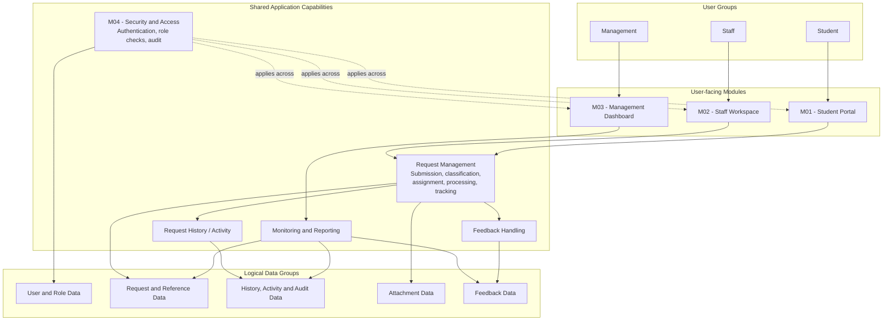

# Architecture Overview

## 1. Purpose

Tài liệu mô tả cấu trúc logic cấp cao của UniSupport và trách nhiệm của các phần chính trong giải pháp. Nội dung được xây dựng từ Project Scope, Domain Model, Functional Requirements, Module PRDs và Workflows; không lựa chọn framework, database, hosting hoặc kiến trúc triển khai khi nguồn chưa quy định.

## 2. Architecture Principles

- **Scope-driven:** Chỉ mô tả các khả năng thuộc phạm vi UniSupport và các workflow WF-01 đến WF-07.
- **Role-based access:** Mọi chức năng và dữ liệu phải được giới hạn theo Student, Staff, Management và quyền được cấp.
- **Centralized request record:** Request là đối tượng dữ liệu trung tâm; thông tin xử lý và lịch sử phải được duy trì xuyên suốt khi phân công hoặc chuyển giao.
- **Traceability:** Thành phần logic phải truy ngược được về FR, module, workflow và Data Requirements.
- **Prototype boundary:** Dùng dữ liệu giả lập; không giả định tích hợp production hoặc dịch vụ bên ngoài.

## 3. Logical Architecture

Sơ đồ thể hiện các nhóm trách nhiệm logic, không khẳng định đây là các service, process hoặc deployment unit độc lập.

## 4. Logical Components and Responsibilities

| Component | Trách nhiệm | Related Module / Requirements |
|---|---|---|
| **M01 – Student Portal** | Cho phép Student gửi Request, xem Request thuộc tài khoản của mình, theo dõi Status/History, nhận thông tin cần hành động, cung cấp bổ sung và gửi Feedback sau khi Request Closed. | FR-STU-01 đến FR-STU-03; WF-01, WF-04, WF-06, WF-07. |
| **M02 – Staff Workspace** | Cho phép Staff xem Request Queue trong phạm vi quyền, phân loại và phân công, xử lý, cập nhật Activity/Status, yêu cầu bổ sung, transfer và ghi nhận Resolution/đóng Request. | FR-STA-01 đến FR-STA-03; WF-02 đến WF-06. |
| **M03 – Management Dashboard** | Tổng hợp Request mới/đang xử lý/quá hạn, thời gian xử lý, số lượng theo Request Type, workload theo Department và Feedback. | FR-MGT-01, FR-MGT-02; dữ liệu phát sinh từ WF-02 đến WF-07. |
| **M04 – Security and Access** | Áp dụng xác thực, kiểm tra Role và phạm vi truy cập, bảo vệ Request/Attachment, ghi nhận Audit Log và hỗ trợ yêu cầu Data Privacy. Áp dụng xuyên suốt M01–M03. | FR-SEC-01, FR-SEC-02; NFR-SEC-01 đến NFR-SEC-07; NFR-REL-02. |
| **Request Management** | Quản lý vòng đời Request từ tiếp nhận đến Closed; duy trì Request ID, Request Type, Priority, Department, Assigned Staff, Status và các mốc thời gian. | Request Model; WF-01 đến WF-06. |
| **Request History / Activity** | Ghi nhận các thay đổi quan trọng và hoạt động xử lý, gồm actor, loại hoạt động, nội dung thay đổi và thời điểm. | Business Rules; Request Model; FR-STA-03; FR-SEC-02. |
| **Feedback Handling** | Lưu Rating/Comment của Student và liên kết với Request đã Closed. | WF-07; FR-STU-03; FR-MGT-02. |
| **Monitoring and Reporting** | Đọc dữ liệu Request, hoạt động xử lý, Department, Request Type và Feedback để hiển thị số liệu quản lý. | FR-MGT-01, FR-MGT-02; M03 PRD. |

## 5. Main Information Flow

1. **Submission – WF-01:** Student gửi thông tin và Attachment (nếu có); hệ thống kiểm tra dữ liệu, tạo Request ID và ghi nhận Request ở trạng thái Received.
2. **Classification and Assignment – WF-02:** Staff xem xét Request, xác định Request Type/Priority, Department và Assigned Staff; các thay đổi phân loại/phân công được ghi nhận.
3. **Processing – WF-03:** Staff xử lý Request, cập nhật Status và Activity; nếu cần thêm thông tin hoặc chuyển đơn vị thì chuyển sang WF-04 hoặc WF-05.
4. **Additional Information – WF-04:** Staff nêu thông tin cần bổ sung; Student gửi thông tin/tài liệu; Request quay lại In Progress khi đủ thông tin.
5. **Transfer – WF-05:** Staff chuyển Request cho Department hoặc Staff phù hợp; Assignment mới và lý do chuyển được ghi nhận, lịch sử trước đó được bảo toàn.
6. **Resolve and Close – WF-06:** Staff ghi Resolution, Request chuyển Resolved rồi Closed; Closed Date được lưu và Student có thể xem kết quả.
7. **Feedback – WF-07:** Student có thể gửi Rating và Comment sau khi Request Closed; Feedback được liên kết với Request để phục vụ báo cáo.

## 6. Cross-cutting Concerns

### Security and Access Control

M04 không phải một màn hình độc lập; các kiểm tra xác thực và quyền truy cập áp dụng khi người dùng mở module, truy vấn dữ liệu hoặc thực hiện thao tác. Quyền cụ thể phải nhất quán với `users-and-roles.md`, FR-SEC-01 và NFR-SEC-01 đến NFR-SEC-04.

### History and Audit

Cần phân biệt:
- **Request History / Activity:** phục vụ theo dõi tiến trình và thay đổi của một Request.
- **Audit Log:** phục vụ kiểm tra hoạt động quan trọng và truy cập/thay đổi dữ liệu theo FR-SEC-02.

Hai nhóm có thể có thông tin giao nhau, nhưng không được mặc định là cùng một khái niệm hoặc cùng một cấu trúc lưu trữ khi chưa có quyết định thiết kế.

### Notifications

Yêu cầu nghiệp vụ có thông báo cho Student khi Status thay đổi hoặc cần bổ sung thông tin. Kênh gửi, cơ chế retry, lưu trạng thái gửi và tích hợp nhà cung cấp chưa được mô tả trong nguồn; các nội dung này là TBD.

### Data Protection

Prototype và test chỉ sử dụng dữ liệu giả lập. Quy tắc retention, archive/deletion và xử lý dữ liệu nhạy cảm phải chờ chính sách Aurora University.

## 7. Architecture Decisions and Open Questions

| ID | Decision / Question | Current position |
|---|---|---|
| AR-OD-01 | Công nghệ giao diện, backend, database, hosting và deployment topology? | TBD – không có quyết định trong nguồn. |
| AR-OD-02 | Request History và Audit Log dùng chung hay tách riêng ở mức lưu trữ? | Phân biệt về mục đích; thiết kế vật lý TBD. |
| AR-OD-03 | Notification được hiển thị/gửi qua kênh nào? | Nguồn chỉ yêu cầu thông báo; kênh và cơ chế TBD. |
| AR-OD-04 | Attachment lưu nội dung tệp ở đâu, giới hạn định dạng/kích thước thế nào? | Chưa có yêu cầu kỹ thuật cụ thể; TBD. |
| AR-OD-05 | Quy tắc tạo và quản lý tài khoản, xác thực, cấp Role và cập nhật Role? | FR-SEC-01 có đề cập; phạm vi User/Role Management cần đối chiếu Project Scope, Master Plan và WBS trước khi cam kết. |
| AR-OD-06 | Quy tắc Department, thời gian xử lý mục tiêu và cách tính overdue? | Cần dữ liệu cấu hình/định nghĩa được nhóm và Sponsor xác nhận; hệ thống không tự đặt SLA. |
| AR-OD-07 | Quy tắc lưu trữ và xử lý dữ liệu nhạy cảm? | TBD – theo chính sách được Aurora University phê duyệt. |
| AR-OD-08 | Request có thể nằm ở Department mà chưa có Assigned Staff hay phải có Staff trước khi hoàn tất Assignment? | WF-02 cho phép chờ Staff; FR-STA-01 yêu cầu người chịu trách nhiệm cụ thể. Cần thống nhất. |
| AR-OD-09 | Workflow nào chịu trách nhiệm chuyển Request sang Resolved? | WF-03 và WF-06 đều mô tả bước chuyển sang Resolved. Cần xác định ranh giới để tránh chuyển trạng thái lặp. |

## 8. Related Documents

- [System Context](./system-context.md)
- [ERD](./erd.md)
- [Data Requirements](./data-requirements.md)
- [Domain Overview](../02-domain/domain-overview.md)
- [Request Model](../02-domain/request-model.md)
- [Request Status](../02-domain/request-status.md)
- [Users and Roles](../02-domain/users-and-roles.md)
- [Functional Requirements](../05-requirements/functional-requirements.md)
- [Non-Functional Requirements](../05-requirements/non-functional-requirements.md)
