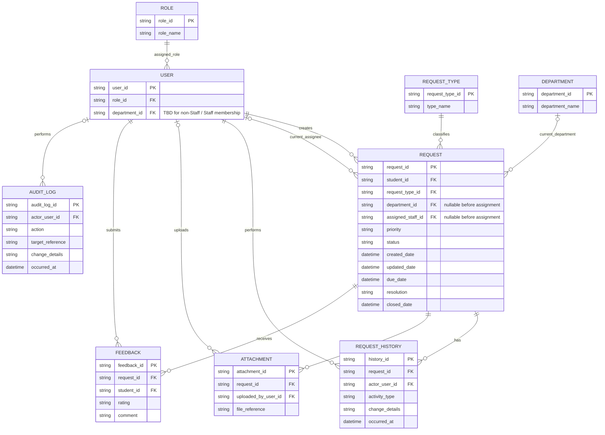

# Entity Relationship Diagram (ERD)

## 1. Purpose

Tài liệu mô tả các thực thể dữ liệu nghiệp vụ chính của UniSupport và quan hệ giữa chúng. ERD được suy ra từ `02-domain/request-model.md`, `02-domain/users-and-roles.md`, `02-domain/request-status.md`, `data-requirements.md`, Functional Requirements và WF-01 đến WF-07.

Đây là **conceptual/logical ERD cho prototype**, không phải physical database schema. Tên bảng, kiểu dữ liệu, khóa kỹ thuật, chuẩn hóa và cách triển khai lưu trữ chưa được quyết định.

## 2. Entity Relationship Diagram

> Ghi chú: ERD thể hiện các liên kết nghiệp vụ được nguồn hỗ trợ. Một số thuộc tính/quan hệ kỹ thuật trong sơ đồ chỉ là placeholder để biểu diễn quan hệ và phải được nhóm xác nhận trước khi chuyển thành schema triển khai.

## 3. Entity Definitions

| Entity | Ý nghĩa và dữ liệu được hỗ trợ bởi nguồn |
|---|---|
| **User** | Đại diện cho người dùng thuộc một trong các nhóm Student, Staff hoặc Management. Dữ liệu người dùng được dùng để xác định người thực hiện và kiểm soát quyền truy cập. Các thuộc tính hồ sơ cụ thể chưa được đặc tả. |
| **Role** | Vai trò truy cập của User: Student, Staff hoặc Management. Entity Role được giữ để biểu diễn Role đã gán cho User và hỗ trợ RBAC. Giao diện Management để xem danh sách User hoặc cập nhật Role (Role Administration) không thuộc phạm vi bàn giao hiện tại. |
| **Department** | Bộ phận chịu trách nhiệm xử lý Request hiện tại; dùng để phân công, chuyển giao và tổng hợp workload. Danh mục và thuộc tính Department chưa được đặc tả. |
| **Request Type** | Danh mục loại yêu cầu; mỗi Request thuộc một loại để phân loại và thống kê vấn đề phổ biến. Các giá trị cụ thể chưa được cung cấp trong domain model. |
| **Request** | Đối tượng trung tâm, gồm Request ID, Student ID, Request Type, Subject, Description, Attachments, Priority, Department, Assigned Staff, Status, Created Date, Updated Date, Due Date, Resolution và Closed Date. |
| **Request History** | Các bản ghi hoạt động/thay đổi của Request: người thực hiện, loại hoạt động, nội dung thay đổi và thời điểm. Bao gồm thay đổi Status, Priority, Assignment, cập nhật xử lý, yêu cầu/cung cấp bổ sung, Transfer và đóng Request. |
| **Attachment** | Tệp/tài liệu được liên kết với Request. Student có thể gửi kèm khi tạo Request hoặc bổ sung sau đó. Metadata và cách lưu nội dung tệp chưa được đặc tả. |
| **Feedback** | Phản hồi của Student sau khi Request Closed; gồm Rating và Comment tùy chọn, được liên kết với Request tương ứng. Nguồn chưa xác định giới hạn số Feedback trên mỗi Request. |
| **Audit Log** | Bản ghi audit theo FR-SEC-02: actor, action, timestamp và đối tượng/thông tin thay đổi. Phạm vi audit gồm các thay đổi quan trọng như Status, Priority, Assignment và thông tin xử lý. Chi tiết event catalog cần nhóm xác nhận. |

## 4. Relationship Rules

- Một Student có thể tạo nhiều Request; mỗi Request thuộc về một Student.
- Mỗi Request thuộc một Request Type; một Request Type có thể được dùng bởi nhiều Request.
- Request có thể chưa có Department hoặc Assigned Staff tại thời điểm tạo/chờ phân công. Khi được phân công, Request có Department và Staff chịu trách nhiệm hiện tại theo domain model.
- Một Department có thể tiếp nhận nhiều Request; một Staff có thể được phân công xử lý nhiều Request.
- Một Request có nhiều Request History records và có thể có nhiều Attachment.
- Một Request có thể có Feedback từ Student sau khi xử lý; số lượng tối đa Feedback chưa được xác định.
- Request History ghi nhận actor là User thực hiện hoạt động.
- Audit Log ghi nhận actor và đối tượng được tác động; target có thể thuộc nhiều loại dữ liệu nên cách tham chiếu cụ thể cần được xác nhận.

## 5. Status and Priority Representation

Các giá trị nghiệp vụ hiện được định nghĩa trong [Request Status](../02-domain/request-status.md):

- **Status:** Received, In Progress, Awaiting Information, Resolved, Closed.
- **Priority:** Low, Medium, Urgent.

Status thể hiện giai đoạn xử lý; Priority thể hiện mức độ ảnh hưởng và tính cấp thiết, không phải một bước của workflow. Request có một Status hiện tại. Chuyển từ Awaiting Information về In Progress được cho phép khi Student cung cấp đủ thông tin. Request phải ở Resolved trước khi chuyển sang Closed.

## 6. Data Integrity and Access Rules

- Request ID phải duy nhất.
- Mỗi Request phải liên kết với Student tạo Request và một Request Type hợp lệ.
- Department và Assigned Staff có thể chưa xác định trước khi hoàn tất phân công.
- Transfer phải giữ Request ID, nội dung, Attachment và lịch sử cũ; Assignment mới và lý do Transfer phải được ghi nhận.
- Thay đổi Status, Priority, Assignment và hoạt động xử lý phải được phản ánh nhất quán trong Request History/Audit theo yêu cầu tương ứng.
- Feedback chỉ được gửi bởi Student có quyền với Request của mình và sau khi Request Closed.
- Student chỉ truy cập Request/Attachment của mình; Staff và Management truy cập theo Department/phạm vi quyền được cấp.
- Prototype/test chỉ sử dụng dữ liệu giả lập.

## 7. Open Design Decisions

| ID | Nội dung cần xác nhận | Lý do |
|---|---|---|
| ERD-OD-01 | User có thể có nhiều Role hay chỉ một Role tại một thời điểm? | Tài liệu mô tả ba Role nhưng chưa định nghĩa cardinality/role assignment history. Sơ đồ hiện biểu diễn một Role hiện tại cho mỗi User như mô hình tối giản; cần xác nhận. |
| ERD-OD-02 | Staff thuộc một Department hay có thể thuộc nhiều Department? | Quyền truy cập có nhắc Department/phạm vi được cấp nhưng chưa có mô hình membership. |
| ERD-OD-03 | Có cần lưu lịch sử Assignment thành entity riêng hay chỉ ghi trong Request History? | Request Model yêu cầu lưu lịch sử thay đổi Assignment; chưa chỉ định cấu trúc vật lý. |
| ERD-OD-04 | Request History và Audit Log là hai entity lưu riêng hay một nguồn dữ liệu với hai cách xem? | Hai khái niệm có mục đích khác nhau trong domain/FR; thiết kế lưu trữ chưa được quyết định. |
| ERD-OD-05 | Một Request được phép có bao nhiêu Feedback? Có cho phép cập nhật Feedback đã gửi không? | Nguồn chỉ nói Request có thể có Feedback và mô tả luồng gửi; chưa có uniqueness/update rule. |
| ERD-OD-06 | Attachment cần lưu những metadata nào, nội dung tệp lưu ở đâu, định dạng/kích thước tối đa? | Chưa có schema hoặc chính sách tệp. |
| ERD-OD-07 | Notification có cần được lưu thành bản ghi riêng không? | Yêu cầu có thông báo nhưng không mô tả notification lifecycle hoặc history. |
| ERD-OD-08 | Due Date được xác định theo cấu hình/thỏa thuận nào và có cần lưu lịch sử thay đổi không? | Dashboard xác định overdue theo thời gian xử lý mục tiêu được cấu hình; chưa có SLA/configuration model. |
| ERD-OD-09 | Audit Log cần ghi nhận truy cập nào ngoài các thay đổi Request? | Đề bài nhắc lịch sử truy cập và thay đổi; FR-SEC-02 mô tả các sự kiện quan trọng nhưng event catalog cần chốt. |
| ERD-OD-10 | Retention, archive và deletion policy cho từng nhóm dữ liệu? | NFR-SEC-06 phụ thuộc chính sách Aurora University chưa được cung cấp. |
| ERD-OD-11 | Request có thể được giữ ở Department khi chưa có Assigned Staff hay Assignment phải luôn có Staff? | WF-02 cho phép chưa có Staff phù hợp; FR-STA-01 lại yêu cầu người chịu trách nhiệm cụ thể. Quan hệ Assigned Staff hiện để nullable và cần nhóm xác nhận. |
| ERD-OD-12 | WF-03 hay WF-06 là nơi cập nhật Request sang Resolved? | Cả hai workflow đều mô tả chuyển sang Resolved; cần thống nhất trước khi chốt state transition và audit event. |

## 8. Related Documents

- [Domain Overview](../02-domain/domain-overview.md)
- [Request Model](../02-domain/request-model.md)
- [Request Status](../02-domain/request-status.md)
- [Users and Roles](../02-domain/users-and-roles.md)
- [Business Rules](../02-domain/business-rules.md)
- [Data Requirements](./data-requirements.md)
- [Functional Requirements](../05-requirements/functional-requirements.md)
- [Non-Functional Requirements](../05-requirements/non-functional-requirements.md)
- [Workflows](../04-workflows/)
