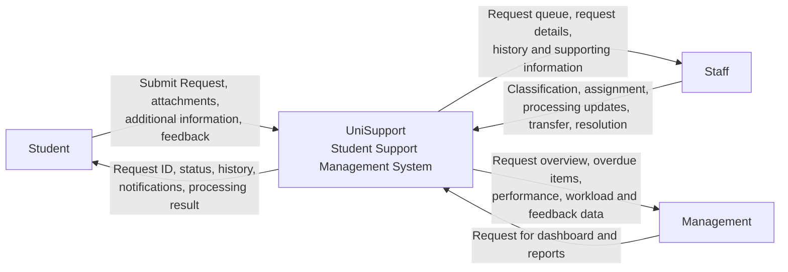

# System Context

## 1. Purpose

Tài liệu mô tả ranh giới của UniSupport, các nhóm người dùng tương tác với hệ thống và những trao đổi thông tin chính. Đây là góc nhìn nghiệp vụ ở mức tổng quan, không xác định công nghệ triển khai.

## 2. System Boundary

**UniSupport – Student Support Management System** là giải pháp hỗ trợ Aurora University quản lý tập trung quá trình tiếp nhận, phân loại, phân công, xử lý và theo dõi yêu cầu hỗ trợ sinh viên.

Trong phạm vi prototype, UniSupport quản lý dữ liệu giả lập và mô phỏng các tương tác cần thiết giữa Student, Staff và Management. Dự án không yêu cầu sản phẩm production hoàn chỉnh hoặc tích hợp thực tế với toàn bộ hệ thống của trường.

### In Scope

- Student gửi Support Request, nhận Request ID và xem trạng thái/lịch sử phù hợp.
- Staff phân loại, xác định Priority, Department và Assigned Staff; xử lý, cập nhật tiến độ, yêu cầu bổ sung thông tin, chuyển giao và đóng Request.
- Student cung cấp thông tin bổ sung và gửi Feedback sau khi Request được đóng.
- Management theo dõi số lượng Request, Request quá hạn, thời gian xử lý, Request Type, workload theo Department và Feedback.
- Kiểm soát truy cập theo Role và phạm vi được cấp; ghi nhận các thay đổi/hoạt động quan trọng.

### Out of Scope for Current Project

- Tích hợp production với hệ thống quản lý đào tạo hoặc các hệ thống khác của trường.
- Sử dụng dữ liệu cá nhân thật của sinh viên.
- Thay thế hệ thống quản lý đào tạo, xử lý thanh toán học phí hoặc tự động quyết định học vụ.
- Triển khai production trên quy mô toàn trường.

Các nội dung ngoài phạm vi hiện tại chỉ có thể được xem xét như future roadmap nếu được phê duyệt riêng.

## 3. External Actors

| Actor | Vai trò và tương tác với UniSupport |
|---|---|
| **Student** | Gửi Request, cung cấp thông tin/tài liệu, xem Request thuộc tài khoản của mình, nhận thông báo liên quan và gửi Feedback sau khi Request được đóng. |
| **Staff** | Xem Request trong phạm vi được cấp, phân loại và phân công, xử lý Request, cập nhật Status/Activity, yêu cầu bổ sung thông tin, chuyển Request và ghi nhận Resolution. |
| **Management** | Xem Dashboard, Request quá hạn, báo cáo hiệu quả xử lý, workload theo Department, Request Type phổ biến và Feedback theo quyền được cấp. |

## 4. Context Interactions

## 5. Information Exchanged

- **Student ↔ UniSupport:** Request details, optional Attachments, Request ID, Status, relevant History, requests for additional information, notifications and Feedback.
- **Staff ↔ UniSupport:** Request details, Classification, Priority, Department/Assigned Staff, processing activities, Status changes, transfer details and Resolution.
- **Management ↔ UniSupport:** Requests for monitoring/reporting information and aggregated information derived from recorded Requests, processing activities and Feedback.

## 6. Security and Privacy Context

- Người dùng phải được xác thực trước khi truy cập các chức năng yêu cầu quyền.
- Student chỉ truy cập Request và Attachment thuộc tài khoản của mình.
- Staff chỉ truy cập Request thuộc Department/phạm vi được phân công hoặc quyền được cấp.
- Management chỉ truy cập Dashboard, báo cáo và dữ liệu quản lý theo quyền được cấp.
- Các thay đổi quan trọng và hoạt động truy cập thuộc phạm vi audit phải được ghi nhận.
- Prototype và testing sử dụng dữ liệu giả lập. Thời hạn lưu trữ và cách xử lý dữ liệu nhạy cảm phải theo chính sách được Aurora University phê duyệt; hiện chưa có chính sách cụ thể trong nguồn.

## 7. Assumptions and Open Decisions

| ID | Nội dung | Trạng thái |
|---|---|---|
| SC-OD-01 | UniSupport được mô tả như một hệ thống logic thống nhất trong prototype; cách triển khai vật lý chưa được quyết định. | TBD – nhóm xác nhận khi lập implementation plan. |
| SC-OD-02 | Các kênh hiện trạng như email, điện thoại, mạng xã hội và trao đổi trực tiếp là bối cảnh vấn đề; chưa có yêu cầu tích hợp các kênh này vào prototype. | Không đưa vào integration scope nếu chưa có phê duyệt. |
| SC-OD-03 | Cơ chế gửi Notification (in-app, email hay cách khác) chưa được xác định trong tài liệu nguồn. | TBD – nhóm xác nhận; không giả định nhà cung cấp/dịch vụ ngoài. |
| SC-OD-04 | Danh sách Department, Request Type và tài khoản mẫu sẽ dùng trong dữ liệu giả lập. | Nhóm xác nhận bộ dữ liệu prototype. |
| SC-OD-05 | Quy tắc lưu trữ, archive/deletion và phân loại dữ liệu nhạy cảm phụ thuộc chính sách của Aurora University. | TBD – cần Sponsor/đơn vị có thẩm quyền xác nhận. |

## 8. Related Documents

- [Project Scope](../01-product/product-scope.md)
- [Domain Overview](../02-domain/domain-overview.md)
- [Users and Roles](../02-domain/users-and-roles.md)
- [Request Model](../02-domain/request-model.md)
- [Request Status](../02-domain/request-status.md)
- [Functional Requirements](../05-requirements/functional-requirements.md)
- [Non-Functional Requirements](../05-requirements/non-functional-requirements.md)
- [Module PRDs](../03-modules/README.md)
- [Workflows](../04-workflows/)
- [Data Requirements](./data-requirements.md)
- [Architecture Overview](./architecture-overview.md)
